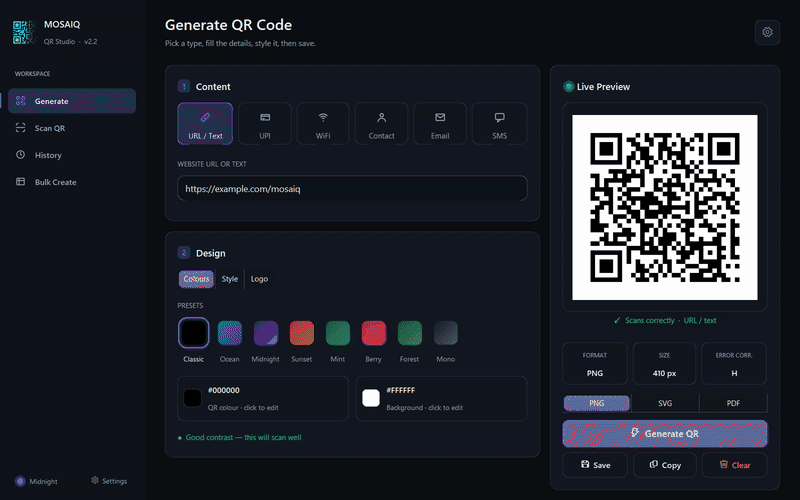
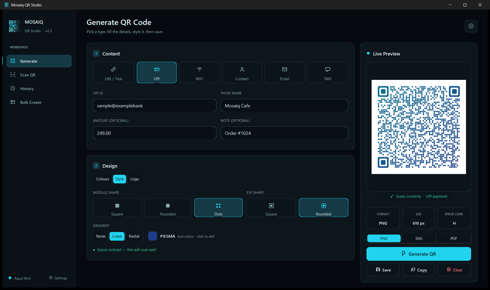
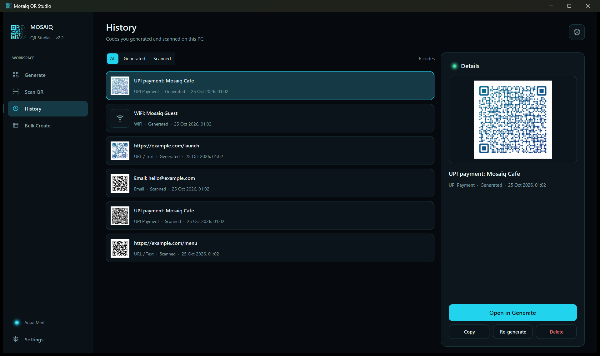
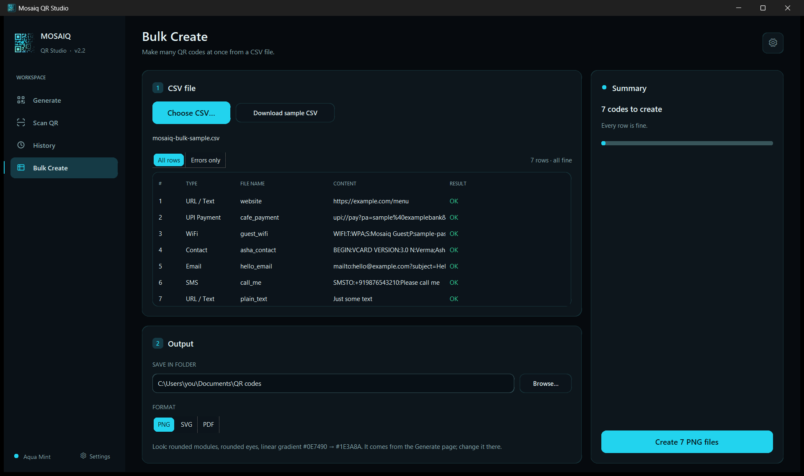

# Mosaiq QR Studio

[](https://apps.microsoft.com/detail/9N8FWDL6NF60)

Make, style, scan and bulk-create QR codes on Windows. Free, offline, no account.



### Highlights

- Styled QR codes for links, UPI, WiFi, contacts, email and SMS, with a test scan that checks they still read
- Export PNG, SVG or PDF; Bulk Create makes up to 1000 codes from a CSV
- Scan from webcam, image files, clipboard or any part of the screen
- Eight themes with a liquid ink theme transition
- Fully offline; history stays on your PC and WiFi passwords are not saved by default

Formerly *QR Code Studio v2*. Current version: 2.2.

## Download

[Get it on the Microsoft Store](https://apps.microsoft.com/detail/9N8FWDL6NF60). Requires Windows 10 version 1809 or later, 64-bit.

## Features

### Generate
- QR codes from a URL or text, or from a small form for each smart type:
  **UPI payment** (UPI ID, payee, optional amount and note), **WiFi** (SSID, password, WPA/WEP/none, hidden),
  **Contact** (vCard 3.0), **Email** (`mailto:`) and **SMS** (`SMSTO:`)
- **Design** in three tabs: colours (eight one-click presets, an in-app colour picker, contrast advice that warns but never blocks), style (square, rounded or dotted modules, square or rounded eyes, linear or radial gradient) and logo (size slider limited to what still scans)
- Your logo in the centre (high error correction, so the code still scans)
- A **test scan** under the preview reads the new code back and says *Scans correctly* or *May not scan*
- Live preview that stays in view while you scroll the form; the file name is asked in the Save dialog (default such as `upi_qr.png`)
- Save as **PNG, SVG or PDF** (SVG is drawn from the same modules as the PNG; PDF holds a picture of at least 2000 px), or copy it to the clipboard

### History
- The codes you generated and scanned, newest first, with filters and **Open**, **Copy**, **Re-generate** and **Delete**
- Local only (`history.json` and small previews next to the settings file). It can be switched off and cleared in Settings. **WiFi passwords are not saved by default**, and then no WiFi preview picture is stored either. Scans keep the decoded text only, never the picture

### Bulk Create
- Load a CSV (a sample can be downloaded in the app), see every row with its own error message, and create up to 1000 codes at once into a folder as PNG, SVG or PDF, with the look chosen on the Generate page
- Progress and Cancel while the window keeps answering; files are never overwritten

### Scan
- **Webcam**: *Use Camera* shows a live preview and decodes the first QR code it sees; it stops itself, and releases the camera on Stop, tab change or exit
- **Image file**: Browse, or **drag and drop** an image onto the Scan page (PNG, JPG/JPEG, WEBP, BMP)
- **Clipboard**: *Paste* (or Ctrl+V) scans an image you copied, e.g. with the Windows Snipping Tool (Win + Shift + S)
- **Screen region**: *Screen Region* hides the window, freezes the screen and lets you drag a box around a QR code
- Recognises UPI, WiFi, contact, email and SMS codes and shows them readably (for example "WiFi: MyNetwork"), with a copy button for the useful value and one for the raw text. Scanning never starts a payment or joins a network by itself.
- Reads dark-mode (light-on-dark) codes, dotted-module codes with a logo, and blurred webcam pictures: several decoding recipes (OpenCV's QR detectors, inverted, adaptive threshold, sharpened) are tried, and the live camera cycles through them one per frame so the preview stays smooth
- Links get **Open link** (default browser) and **Copy link**; every result has only buttons that do different things

### Look and feel
- Full-screen animated intro in three palettes: Aqua Mint, Ultraviolet, Ember (can be turned off in Settings)
- Eight themes with live preview: Midnight, Graphite, AMOLED, Aqua Mint, Ultraviolet, Ember, Emerald and the light Daylight
- A **liquid ink transition** (three blobs, droplets, a glowing edge; 2 s, click or key skips it) plays over the whole window (the Settings page included) when the theme changes. It is switched off by *Animate theme changes* in Settings and by Windows' "Animation effects" setting, and never runs at start-up.
- **Settings is a page of the main window** (the last entry of the sidebar, or the gear in the header), so the transition covers all of it. Themes preview live, the Apply / Cancel footer is always visible, **Apply** saves everything, **Cancel** goes back, and leaving the page or closing the app with unsaved changes asks *Save changes?*; the saved theme is used on the next start. Every theme change is noted in `mosaiq.log` (started, finished, or why it was skipped)
- Works fully offline; nothing is collected or sent ([privacy policy](PRIVACY.md))

## Screenshots


| Generate | Style |
|---|---|
|  |  |
| **Scan** | **History** |
|  |  |
| **Bulk Create** | **Settings and themes** |
|  |  |
| **Light mode** | |
|  | |

## Run from source

Windows 10/11 and Python 3.13:

```powershell
git clone https://github.com/Vishesh233/Mosaiq-QR-Studio.git
cd Mosaiq-QR-Studio
python -m venv .venv
.\.venv\Scripts\python.exe -m pip install -r requirements.txt
.\.venv\Scripts\python.exe main.py
```

To skip the intro, run `main.py --no-splash` or set `QRSTUDIO_NO_SPLASH=1`.

## Tests

Run from the repository root with the venv's Python. There are 26 test scripts (`_*_test.py`); `_run_all_tests.py` runs 24 of them by default, and `--exe` adds the two that need a build (`_frozen_exe_test.py`, `_installed_app_test.py`). Run `.\.venv\Scripts\python.exe _run_all_tests.py` (`--skip-desktop` leaves out the webcam, screen-region and drag-and-drop tests, which use the real desktop; the drag-and-drop test moves the mouse by itself for a few seconds). Tests open their windows off-screen and never show a real message box or file dialog: dialogs are replaced by recorders, and an unexpected error box fails the test. A test that leaves a process running fails too.

| Script | Covers |
|---|---|
| `_roundtrip_test.py` | every QR type: build, generate, scan, parse; scanner edge cases |
| `_smoke_test.py` | the UI: navigation, all six generate forms, scan results, clipboard, settings, themes |
| `_func_test.py` | generate, scan and clipboard without the UI |
| `_generate_ui_test.py`, `_scan_ui_test.py` | the redesigned Generate and Scan pages: alignment, sticky preview and result card, minimum window size, Save dialog, file names |
| `_design_features_test.py`, `_style_render_test.py`, `_color_picker_test.py` | presets and contrast advice, the test-scan badge, logo limits, every style scans, the colour picker |
| `_export_test.py` | PNG, SVG (valid XML, drawn by Edge, equal to the PNG) and PDF (at least 2000 px, scans back) |
| `_history_test.py`, `_history_ui_test.py` | the history store and the History page, WiFi privacy (every saved preview is decoded to prove no password), Settings switches |
| `_bulk_test.py`, `_bulk_ui_test.py` | CSV reading and per-row errors, the 1000-row limit, file names, the worker, Cancel, formats, progress without a frozen window |
| `_theme_contrast_test.py` | contrast of every theme and every widget, live theme switching |
| `_theme_transition_test.py` | the liquid blob theme transition: mask maths and patch order, snapshot of the app window only, the Settings page (a click on a theme card animates the whole window), skip on click / key / move / resize / minimize / focus loss, changes never overlap, the log reason of every start and skip, off switches, frame-time benchmark |
| `_theme_leak_test.py` | theme leak audit: 65 switch sequences (30 with the animation, 35 without; skipped, interrupted, quick, from the Settings page) on every page; no widget and no painted area may keep a colour of another theme |
| `_settings_persist_test.py` | the Settings page: Apply writes every setting atomically, Cancel and "Don't save" write nothing, leaving the page or closing the app with changes asks "Save changes?", a failed write is reported, the next launch uses the saved theme, the footer is always visible at 100 / 125 / 150 % |
| `_status_dot_test.py` | the card status dot (dim, then bright with a glow once there is a result) on every page, the fade, and the sidebar's theme dot in every theme |
| `_defaults_test.py` | a fresh install: intro animation on, history on, WiFi passwords off |
| `_window_visible_test.py` | the window is on a monitor after start-up, even from an off-screen position |
| `_region_test.py` | screen-region overlay, crop mapping, window restore |
| `_camera_test.py` | webcam thread, fake and real camera, release on stop, tab change and exit |
| `_dnd_test.py` | drag and drop fallback, and real OLE drops (needs `tkinterdnd2`) |
| `_cv2_missing_test.py` | OpenCV loads lazily; if it cannot load (Windows N without the Media Feature Pack) the app starts, Generate works, Scan/Camera show a clear message and the cause is logged |
| `_frozen_exe_test.py` | the built exe: PerMonitorV2 DPI awareness, real Screen Region scan at the PC's display scaling, clean exit (build first) |
| `_installed_app_test.py` | drives the real app window (the built exe, or the installed Store package): Generate a code, scan it back, close; moves the mouse and types, window-only capture (build first) |
| `packaging\msix\install_test.ps1` | not run by `_run_all_tests.py`; from an Administrator PowerShell: signs a copy of the MSIX with a throw-away certificate, runs the Windows App Certification Kit (WACK), installs the copy, runs `_installed_app_test.py` in it, then uninstalls and removes the certificate |

Screenshots are made by two tools that capture only the app's own window (never the screen) with throw-away settings: `_theme_shots.py <folder>` (Generate, Scan, History, Bulk Create, Settings and the colour picker in every theme) and `_store_shots.py <folder>` (the 1920 x 1140 Store pictures in `assets/images`).

## Build

| Output | Command |
|---|---|
| Windows app (PyInstaller, one folder) | `.\build.ps1` → `dist\MosaiqQRStudio\MosaiqQRStudio.exe` |
| Microsoft Store package (MSIX) | `.\build_msix.ps1` → `dist\MosaiqQRStudio-<version>-x64.msix` |

Details, test checklist and release steps are in [WINDOWS_BUILD.md](WINDOWS_BUILD.md).

## Tech stack

Python · CustomTkinter · Pillow · NumPy (intro renderer) · OpenCV (`cv2.QRCodeDetector`, webcam) · qrcode · pywin32 (clipboard) · tkinterdnd2 (drag and drop, optional) · PyInstaller · MSIX

## Project structure

```
Mosaiq-QR-Studio/
├── main.py, config.py
├── ui/                  # app shell, pages (incl. Settings), components, dialogs
│   ├── pages/           # Generate, Scan, History, Bulk Create, Settings
│   ├── splash.py        # animated intro (NumPy renderer)
│   └── brand_logo.py    # logo and app icon, drawn in code
├── utils/               # QR generator and renderer, export, history, bulk, payload types, scanner, camera, screen capture, clipboard, themes, settings
├── docs/design/         # UI mockups the redesign follows
├── reference/           # intro data: QR matrix and wordmark font
├── assets/              # app icon, screenshots, thumbnails
├── packaging/msix/      # Store manifest, identity, logo assets, listing text
├── QRCodeStudio.spec    # PyInstaller build
├── build.ps1, build_msix.ps1
└── requirements.txt
```

## Working on this repo with an AI agent

Standing rules (never stop processes by name or in bulk, only your own PIDs; window-only screenshots; no AI attribution in commits) are in [AGENTS.md](AGENTS.md).

## Roadmap

Planned for 2.3:

- Faster theme refresh
- Faster first scan (OpenCV's cold load takes about 3.5 s)
- Quicker Dark ↔ Light switch
- More QR types and templates

## Author

**Vishesh Khanna**

- GitHub: https://github.com/Vishesh233
- LinkedIn: https://linkedin.com/in/vishesh-khanna-210361252
