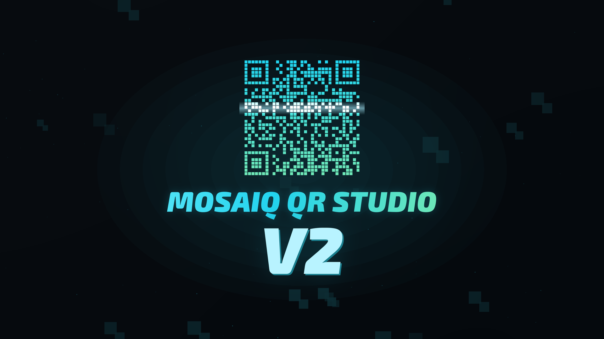
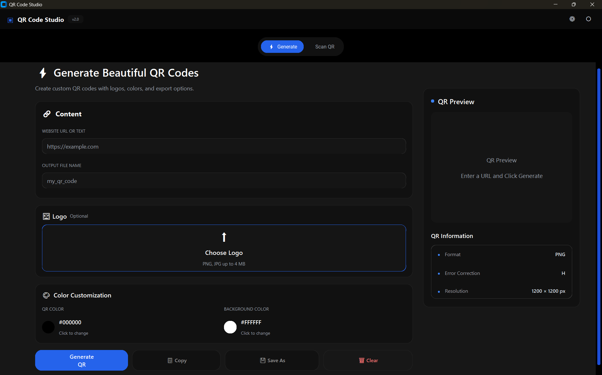
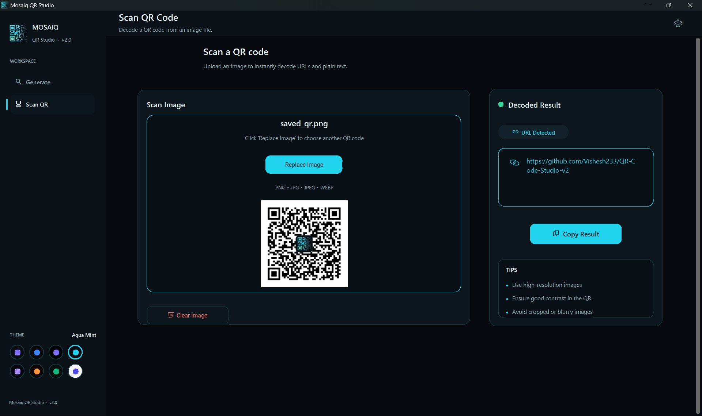
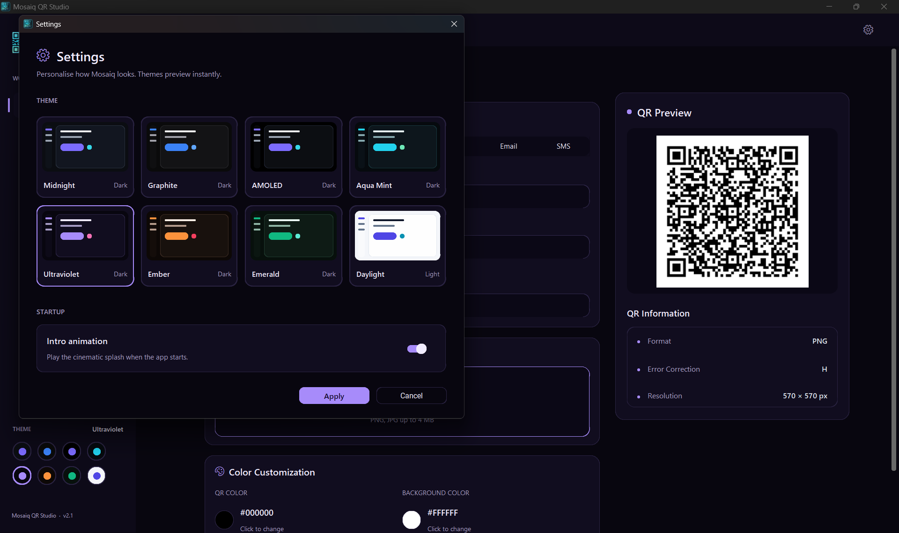
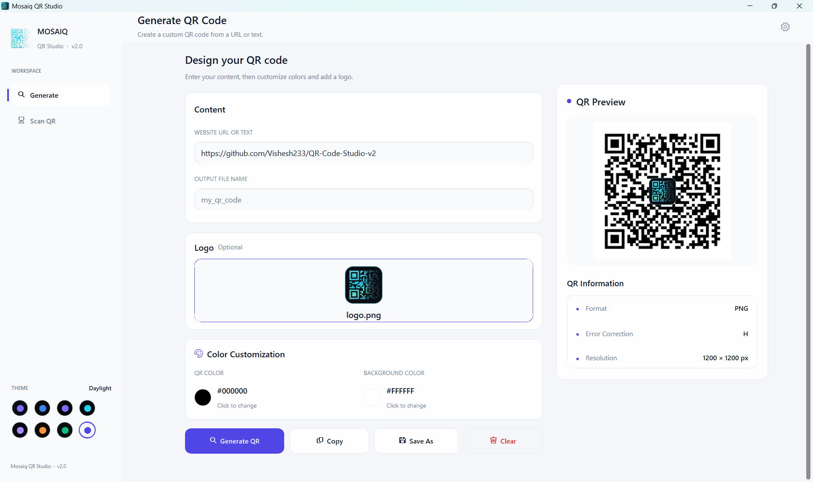

# Mosaiq QR Studio



A Windows desktop app for making and scanning QR codes, with a cinematic intro and eight themes.
Formerly *QR Code Studio v2*. Coming to the Microsoft Store.

## Features

### Generate
- QR codes from a URL or text, or from a small form for each smart type:
  **UPI payment** (UPI ID, payee, optional amount and note), **WiFi** (SSID, password, WPA/WEP/none, hidden),
  **Contact** (vCard 3.0), **Email** (`mailto:`) and **SMS** (`SMSTO:`)
- Custom QR and background colours
- Your logo in the centre (high error correction, so the code still scans)
- Live preview, then save as PNG or copy it to the clipboard

### Scan
- **Webcam**: *Use Camera* shows a live preview and decodes the first QR code it sees; it stops itself, and releases the camera on Stop, tab change or exit
- **Image file**: Browse, or **drag and drop** an image onto the Scan page (PNG, JPG/JPEG, WEBP, BMP)
- **Clipboard**: *Paste* (or Ctrl+V) scans an image you copied, e.g. with the Windows Snipping Tool (Win + Shift + S)
- **Screen region**: *Screen Region* hides the window, freezes the screen and lets you drag a box around a QR code
- Recognises UPI, WiFi, contact, email and SMS codes and shows them readably (for example "WiFi: MyNetwork"), with a copy button for the useful value and one for the raw text. Scanning never starts a payment or joins a network by itself.
- Reads dark-mode (light-on-dark) codes, dotted-module codes with a logo, and blurred webcam pictures: several decoding recipes (OpenCV's QR detectors, inverted, adaptive threshold, sharpened) are tried, and the live camera cycles through them one per frame so the preview stays smooth
- Links get **Open link** (default browser) and **Copy link**; every result has only buttons that do different things

### Look and feel
- Full-screen animated intro in three palettes: Aqua Mint, Ultraviolet, Ember (can be turned off in Settings)
- Eight themes with live preview: Midnight, Graphite, AMOLED, Aqua Mint, Ultraviolet, Ember, Emerald and the light Daylight
- Remembers your theme and intro preference
- Works fully offline; nothing is collected or sent ([privacy policy](PRIVACY.md))

## Screenshots

| Generate | Scan |
|---|---|
|  |  |
| **Themes** | **Light mode** |
|  |  |

## Run from source

Windows 10/11 and Python 3.13:

```powershell
git clone https://github.com/Vishesh233/Mosaiq-QR-Studio.git
cd Mosaiq-QR-Studio
python -m venv .venv
.\.venv\Scripts\python.exe -m pip install -r requirements.txt
.\.venv\Scripts\python.exe main.py
```

To skip the intro, run `main.py --no-splash` or set `QRSTUDIO_NO_SPLASH=1`.

## Tests

Run from the repository root with the venv's Python (they open real windows; the drag-and-drop test moves the mouse by itself for a few seconds):

| Script | Covers |
|---|---|
| `_roundtrip_test.py` | every QR type: build, generate, scan, parse; scanner edge cases |
| `_smoke_test.py` | the UI: navigation, all six generate forms, scan results, clipboard, settings, themes |
| `_func_test.py` | generate, scan and clipboard without the UI |
| `_region_test.py` | screen-region overlay, crop mapping, window restore |
| `_camera_test.py` | webcam thread, fake and real camera, release on stop, tab change and exit |
| `_dnd_test.py` | drag and drop fallback, and real OLE drops (needs `tkinterdnd2`) |

## Build

| Output | Command |
|---|---|
| Windows app (PyInstaller, one folder) | `.\build.ps1` → `dist\MosaiqQRStudio\MosaiqQRStudio.exe` |
| Microsoft Store package (MSIX) | `.\build_msix.ps1` → `dist\MosaiqQRStudio-<version>-x64.msix` |

Details, test checklist and release steps are in [WINDOWS_BUILD.md](WINDOWS_BUILD.md).

## Tech stack

Python · CustomTkinter · Pillow · NumPy (intro renderer) · OpenCV (`cv2.QRCodeDetector`, webcam) · qrcode · pywin32 (clipboard) · tkinterdnd2 (drag and drop, optional) · PyInstaller · MSIX

## Project structure

```
Mosaiq-QR-Studio/
├── main.py, config.py
├── ui/                  # app shell, pages, components, settings dialog
│   ├── splash.py        # animated intro (NumPy renderer)
│   └── brand_logo.py    # logo and app icon, drawn in code
├── utils/               # QR generator, payload types, scanner, camera, screen capture, clipboard, themes, settings
├── reference/           # intro data: QR matrix and wordmark font
├── assets/              # app icon, screenshots, thumbnails
├── packaging/msix/      # Store manifest, identity, logo assets, listing text
├── QRCodeStudio.spec    # PyInstaller build
├── build.ps1, build_msix.ps1
└── requirements.txt
```

## Roadmap

- History of generated and scanned codes
- Batch generation

## Author

**Vishesh Khanna**

- GitHub: https://github.com/Vishesh233
- LinkedIn: https://linkedin.com/in/vishesh-khanna-210361252
